# math3d-next vs math3d-react: slider animation

Production: `next.math3d.org` at release `v2026.11.21.1` (`e2ebc916`) vs `math3d.org`, measured 2026-11-20. Each scene animates a slider `T` on load, so the surface, its colors or the field change every frame.

## Summary

- **Native CPU (M1 Pro): math3d-next is ahead on color maps and implicit surfaces, and about even on solid-color surfaces and vector fields.**
  - Solid-color surfaces and vector fields: math3d-next uses 0–12% more main-thread time per frame; both hold 60 fps, except on the shell, where both run at about 56.
  - Color maps: math3d-next uses 26–51% less main-thread time on all four color-mapped scenes, and has the higher frame rate on two (sphere 60 vs 53, 256 × 256 ripple 27 vs 20); the 128 × 128 ripple runs at 60 vs 56 and the torus at 60 in both.
  - Implicit surfaces: math3d-next holds 60 fps at 20 and 40 samples; math3d-react falls to 3.6 fps (gyroid, 40), using 3–43× more main-thread time.
- **With the CPU slowed 4×, math3d-next is behind on solid-color surfaces and vector fields**: 1.2–1.3× math3d-react's main-thread time, and fewer fps on the shell (13 vs 16) and the 4,000 arrows (48 vs 60); the 64 × 64 ripple and the 500 arrows still run at about 60 in both. It stays ahead on color maps and implicit surfaces.
- _Likely causes of the 4× gap, from profiling not included here:_ evaluating the expression at every sample (math3d-react's mathjs 3 compiles each expression to JavaScript; math3d-next evaluates its parsed expression tree), and the store update and React re-render on each slider step.

## Native CPU speed

math3d-react vs math3d-next (three.js). Frames per second, and main-thread task time per frame (ms). Medians of 9 runs, 5 s each, interleaved between the apps. 60 fps is the display cap, so where both hit it, main-thread time shows the headroom. Result compares frame rates: 🟢 math3d-next more than 10% higher, 🟢🟢 at least twice as high, 🔵 within 10% (with math3d-next's main-thread time against math3d-react's when it differs by more than 15%), 🟠 more than 10% lower. Run-to-run spread ((max − min) / median of ms per frame): math3d-next 1–7%, math3d-react 2–17%.

| Scene                                                                                         | math3d-react fps | math3d-next fps | math3d-react ms | math3d-next ms | Result                                |
| --------------------------------------------------------------------------------------------- | ---------------: | --------------: | --------------: | -------------: | ------------------------------------- |
| **Sphere, color map** Parametric surface · 128 × 128, color map moves, geometry fixed      |               53 |              60 |            18.3 |            9.0 | 🟢 math3d-next ahead                  |
| **Ripple** Explicit surface · 64 × 64, solid color                                         |               60 |              60 |             5.2 |            5.4 | 🔵 even                               |
| **Ripple, color map** Explicit surface · 128 × 128, rainbow color map                      |               56 |              60 |            17.6 |           11.9 | 🔵 even; math3d-next main thread -32% |
| **Ripple, color map** Explicit surface · 256 × 256, rainbow color map                      |               20 |              27 |            50.2 |           37.3 | 🟢 math3d-next ahead                  |
| **Wavy torus, color map** Parametric surface · 96 × 96, temperature color map              |               60 |              60 |            16.1 |           11.0 | 🔵 even; math3d-next main thread -31% |
| **Shell, user function** Parametric surface · 128 × 128, solid color, f and A user-defined |               56 |              56 |            17.3 |           18.0 | 🔵 even                               |
| **Moving sphere** Implicit surface · 20 samples per axis                                   |               60 |              60 |            14.6 |            4.9 | 🔵 even; math3d-next main thread -66% |
| **Moving sphere** Implicit surface · 40 samples per axis                                   |               11 |              60 |            90.9 |            6.1 | 🟢🟢 math3d-next ahead, 2× or more    |
| **Gyroid** Implicit surface · 20 samples per axis                                          |               24 |              60 |            42.4 |            4.9 | 🟢🟢 math3d-next ahead, 2× or more    |
| **Gyroid** Implicit surface · 40 samples per axis                                          |              3.6 |              60 |           294.2 |            6.8 | 🟢🟢 math3d-next ahead, 2× or more    |
| **Vector field** Vector field · 10 × 10 × 5 = 500 arrows                                   |               60 |              60 |             4.9 |            4.9 | 🔵 even                               |
| **Vector field** Vector field · 20 × 20 × 10 = 4,000 arrows                                |               60 |              60 |             5.4 |            6.0 | 🔵 even                               |

## CPU slowed 4×

Chrome's CPU throttling, as a stand-in for a slower machine (roughly a low-end laptop against this M1 Pro). Medians of 6 runs. Run-to-run spread: math3d-next 0–10%, math3d-react 0–19%.

| Scene                                                                                         | math3d-react fps | math3d-next fps | math3d-react ms | math3d-next ms | Result                                |
| --------------------------------------------------------------------------------------------- | ---------------: | --------------: | --------------: | -------------: | ------------------------------------- |
| **Sphere, color map** Parametric surface · 128 × 128, color map moves, geometry fixed      |               15 |              28 |            67.4 |           35.9 | 🟢 math3d-next ahead                  |
| **Ripple** Explicit surface · 64 × 64, solid color                                         |               60 |              58 |            14.3 |           17.0 | 🔵 even; math3d-next main thread +19% |
| **Ripple, color map** Explicit surface · 128 × 128, rainbow color map                      |               16 |              21 |            62.6 |           48.5 | 🟢 math3d-next ahead                  |
| **Ripple, color map** Explicit surface · 256 × 256, rainbow color map                      |              4.9 |             6.5 |           208.2 |          156.2 | 🟢 math3d-next ahead                  |
| **Wavy torus, color map** Parametric surface · 96 × 96, temperature color map              |               18 |              22 |            55.3 |           44.6 | 🟢 math3d-next ahead                  |
| **Shell, user function** Parametric surface · 128 × 128, solid color, f and A user-defined |               16 |              13 |            62.4 |           75.1 | 🟠 math3d-next behind                 |
| **Moving sphere** Implicit surface · 20 samples per axis                                   |               18 |              60 |            56.1 |           13.2 | 🟢🟢 math3d-next ahead, 2× or more    |
| **Moving sphere** Implicit surface · 40 samples per axis                                   |              2.7 |              47 |           384.7 |           21.2 | 🟢🟢 math3d-next ahead, 2× or more    |
| **Gyroid** Implicit surface · 20 samples per axis                                          |              5.8 |              60 |           172.5 |           13.2 | 🟢🟢 math3d-next ahead, 2× or more    |
| **Gyroid** Implicit surface · 40 samples per axis                                          |              0.9 |              40 |          1250.4 |           24.9 | 🟢🟢 math3d-next ahead, 2× or more    |
| **Vector field** Vector field · 10 × 10 × 5 = 500 arrows                                   |               60 |              60 |             9.8 |           13.1 | 🔵 even; math3d-next main thread +34% |
| **Vector field** Vector field · 20 × 20 × 10 = 4,000 arrows                                |               60 |              48 |            15.7 |           20.9 | 🟠 math3d-next behind                 |

## Screenshots

Taken mid-animation at the end of the last native-speed run, so `T` differs between the two. math3d-react shows MathBox's loading spinner when it falls behind. At 40 samples its gyroid draws nothing and its fields show red underlines; we haven't looked into why.

### Sphere, color map

Parametric surface · 128 × 128, color map moves, geometry fixed · `3f(u,v), color g(u − T, v)`

| math3d-react                                                                                                     | math3d-next                                                                                                    |
| ---------------------------------------------------------------------------------------------------------------- | -------------------------------------------------------------------------------------------------------------- |
| 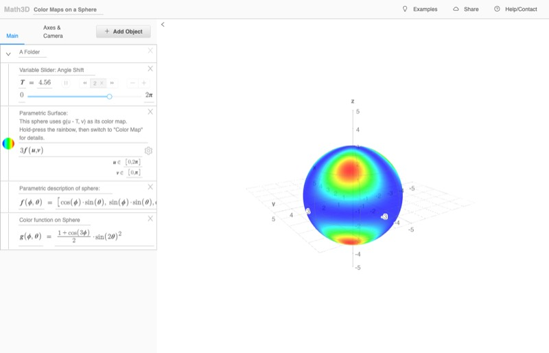 | 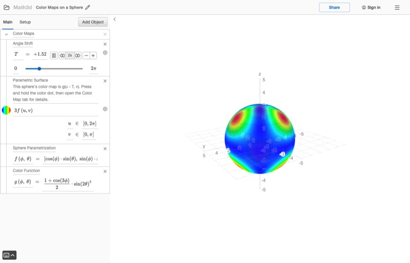 |
| 53 fps · 18.3 ms/frame                                                                                           | 60 fps · 9.0 ms/frame                                                                                          |

### Ripple

Explicit surface · 64 × 64, solid color · `sin(2√(x²+y²) − T) / (1 + 0.3(x²+y²))`

| math3d-react                                                              | math3d-next                                                             |
| ------------------------------------------------------------------------- | ----------------------------------------------------------------------- |
| 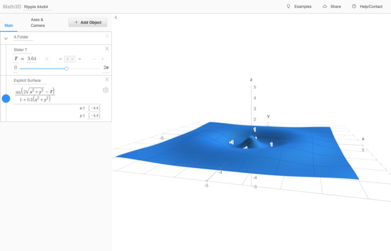 | 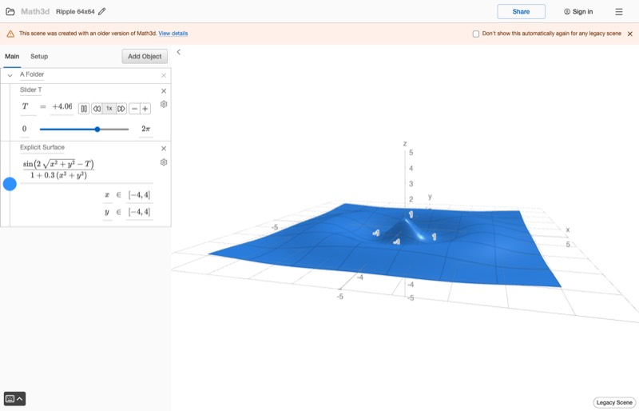 |
| 60 fps · 5.2 ms/frame                                                     | 60 fps · 5.4 ms/frame                                                   |

### Ripple, color map

Explicit surface · 128 × 128, rainbow color map · `same surface; color (1 + sin(2√(x²+y²) − T)) / 2`

| math3d-react                                                                                       | math3d-next                                                                                      |
| -------------------------------------------------------------------------------------------------- | ------------------------------------------------------------------------------------------------ |
| 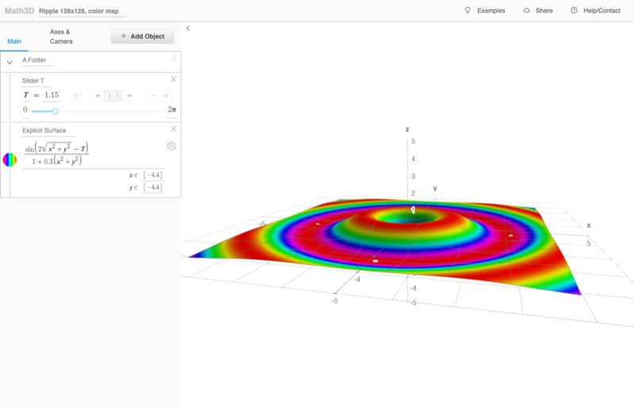 | 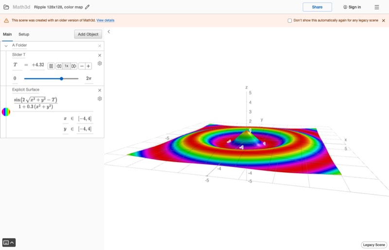 |
| 56 fps · 17.6 ms/frame                                                                             | 60 fps · 11.9 ms/frame                                                                           |

### Ripple, color map

Explicit surface · 256 × 256, rainbow color map · `same as above`

| math3d-react                                                                                       | math3d-next                                                                                      |
| -------------------------------------------------------------------------------------------------- | ------------------------------------------------------------------------------------------------ |
| 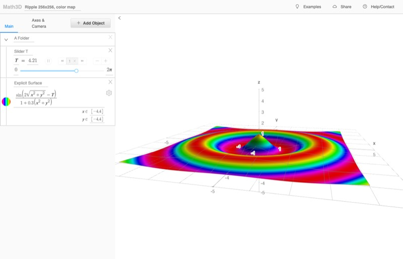 | 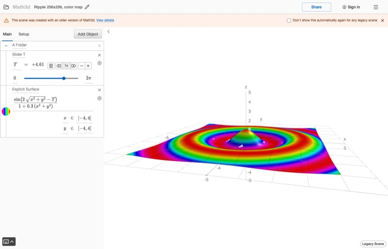 |
| 20 fps · 50.2 ms/frame                                                                             | 27 fps · 37.3 ms/frame                                                                           |

### Wavy torus, color map

Parametric surface · 96 × 96, temperature color map · `[(2+cos v) cos u, (2+cos v) sin u, sin v + 0.4 sin(3u+T)]`

| math3d-react                                                                                           | math3d-next                                                                                          |
| ------------------------------------------------------------------------------------------------------ | ---------------------------------------------------------------------------------------------------- |
| 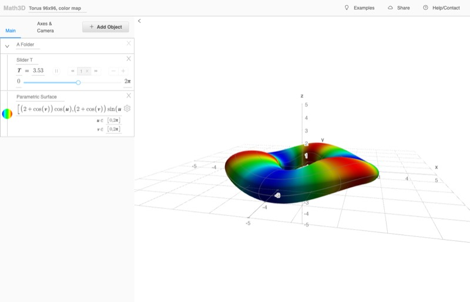 | 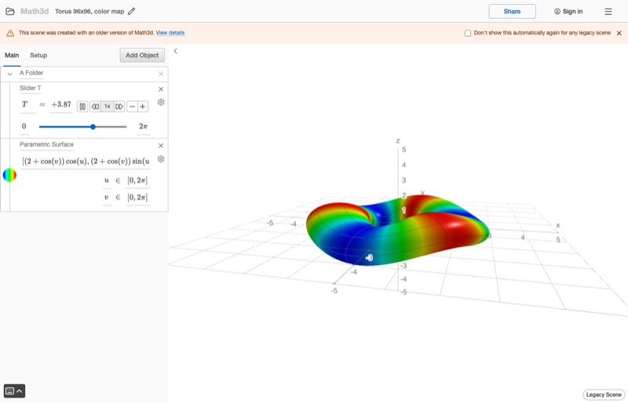 |
| 60 fps · 16.1 ms/frame                                                                                 | 60 fps · 11.0 ms/frame                                                                               |

### Shell, user function

Parametric surface · 128 × 128, solid color, f and A user-defined · `f(u,v) = e^{0.12u}[(1+A cos v) cos u, …], A = 0.6 + 0.3 sin T`

| math3d-react                                                                                                    | math3d-next                                                                                                   |
| --------------------------------------------------------------------------------------------------------------- | ------------------------------------------------------------------------------------------------------------- |
| 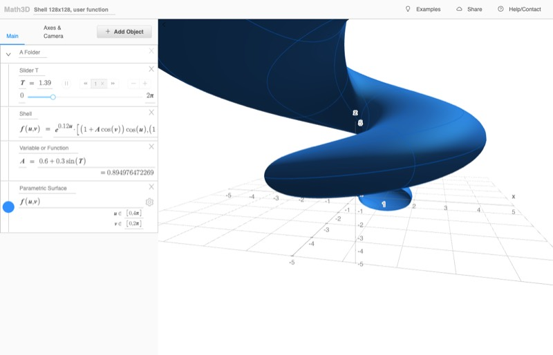 | 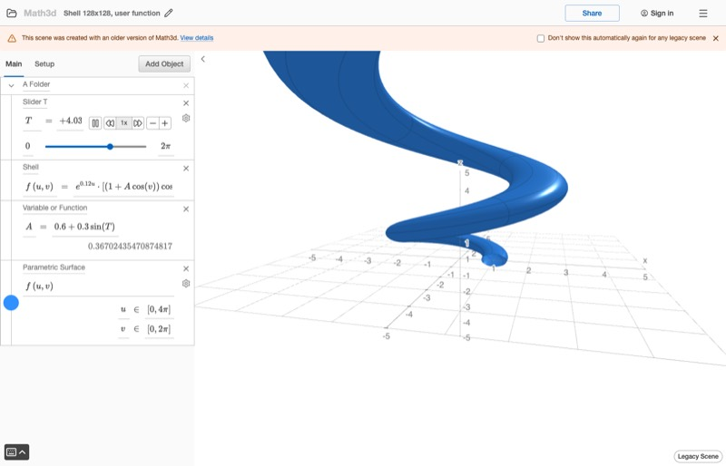 |
| 56 fps · 17.3 ms/frame                                                                                          | 56 fps · 18.0 ms/frame                                                                                        |

### Moving sphere

Implicit surface · 20 samples per axis · `(x − T)² + y² + z² = 4`

| math3d-react                                                                             | math3d-next                                                                            |
| ---------------------------------------------------------------------------------------- | -------------------------------------------------------------------------------------- |
| 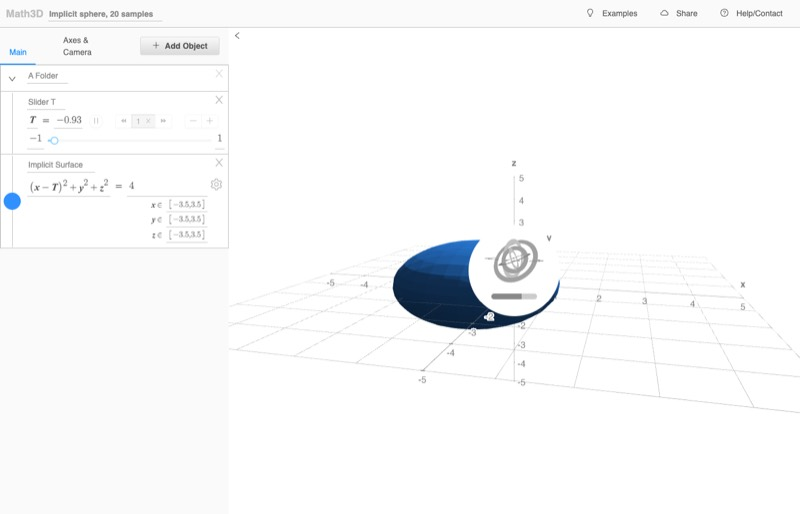 | 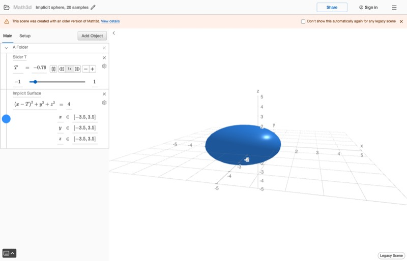 |
| 60 fps · 14.6 ms/frame                                                                   | 60 fps · 4.9 ms/frame                                                                  |

### Moving sphere

Implicit surface · 40 samples per axis · `(x − T)² + y² + z² = 4`

| math3d-react                                                                             | math3d-next                                                                            |
| ---------------------------------------------------------------------------------------- | -------------------------------------------------------------------------------------- |
| 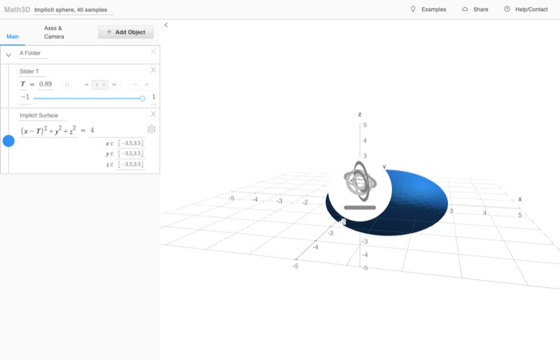 | 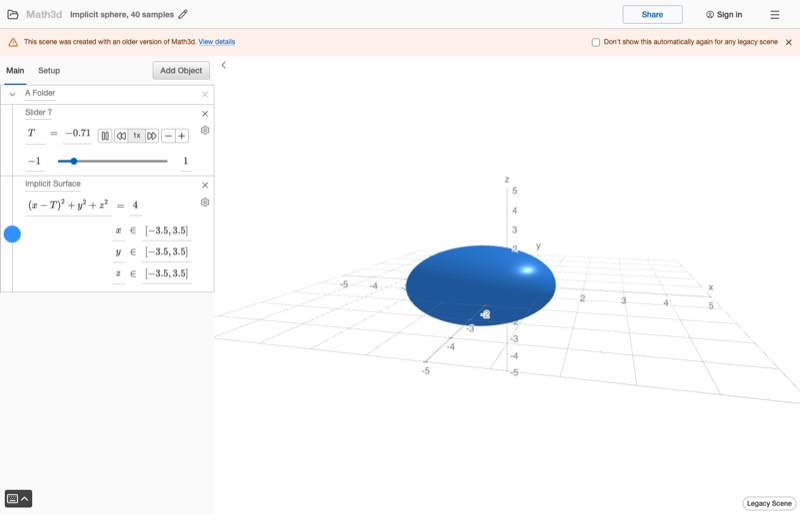 |
| 11 fps · 90.9 ms/frame                                                                   | 60 fps · 6.1 ms/frame                                                                  |

### Gyroid

Implicit surface · 20 samples per axis · `sin(T x) cos y + sin y cos z + sin z cos x = 0`

| math3d-react                                                             | math3d-next                                                            |
| ------------------------------------------------------------------------ | ---------------------------------------------------------------------- |
| 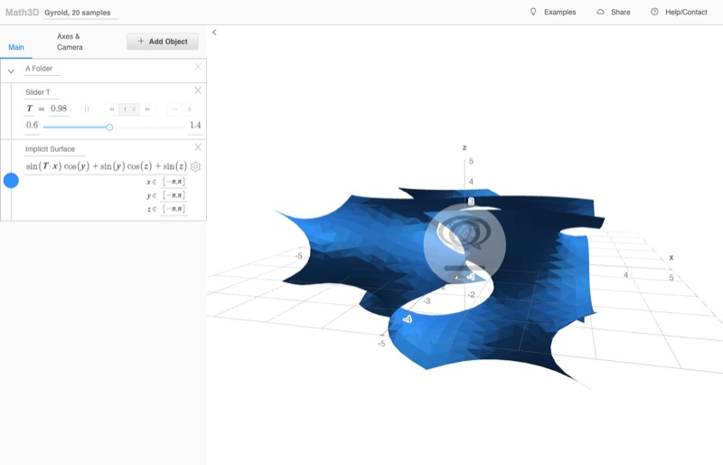 |  |
| 24 fps · 42.4 ms/frame                                                   | 60 fps · 4.9 ms/frame                                                  |

### Gyroid

Implicit surface · 40 samples per axis · `sin(T x) cos y + sin y cos z + sin z cos x = 0`

| math3d-react                                                             | math3d-next                                                            |
| ------------------------------------------------------------------------ | ---------------------------------------------------------------------- |
| 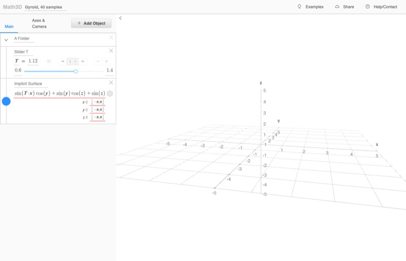 | 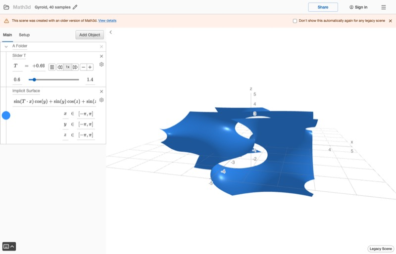 |
| 3.6 fps · 294.2 ms/frame                                                 | 60 fps · 6.8 ms/frame                                                  |

### Vector field

Vector field · 10 × 10 × 5 = 500 arrows · `[−y + 0.5 sin(z+T), x, 0.5 cos(x+T)]`

| math3d-react                                                                       | math3d-next                                                                      |
| ---------------------------------------------------------------------------------- | -------------------------------------------------------------------------------- |
| 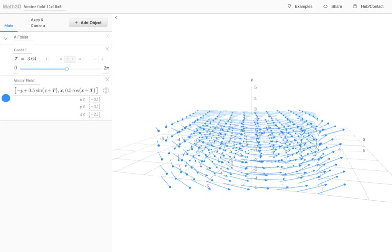 | 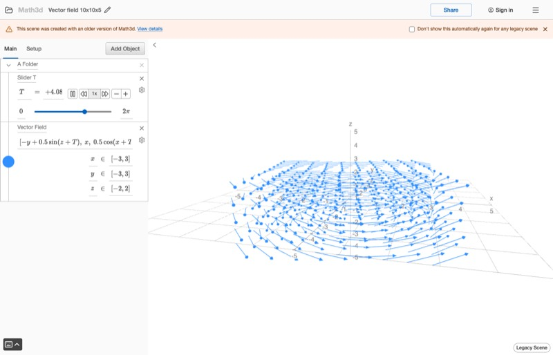 |
| 60 fps · 4.9 ms/frame                                                              | 60 fps · 4.9 ms/frame                                                            |

### Vector field

Vector field · 20 × 20 × 10 = 4,000 arrows · `[−y + 0.5 sin(z+T), x, 0.5 cos(x+T)]`

| math3d-react                                                                          | math3d-next                                                                         |
| ------------------------------------------------------------------------------------- | ----------------------------------------------------------------------------------- |
| 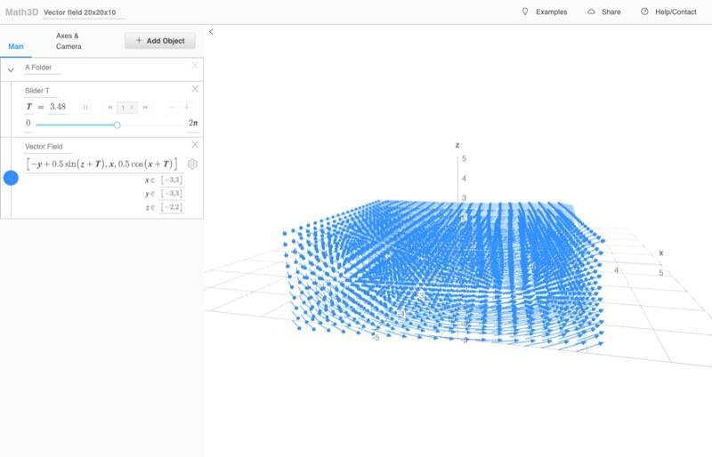 | 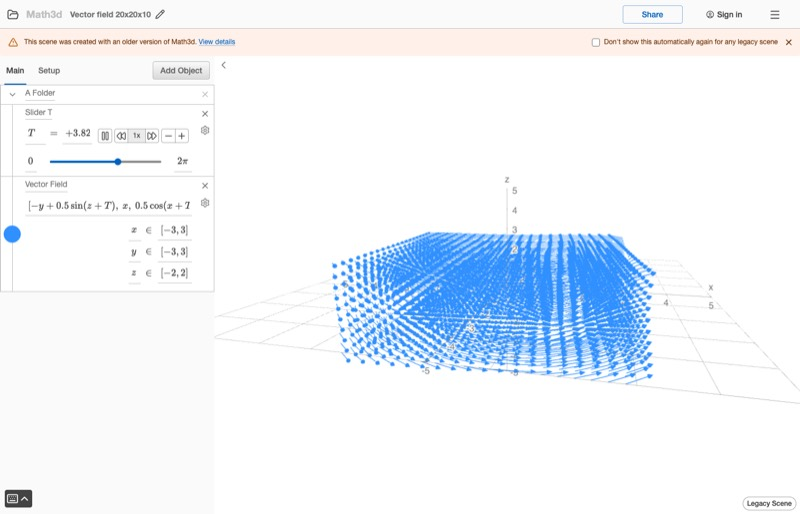 |
| 60 fps · 5.4 ms/frame                                                                 | 60 fps · 6.0 ms/frame                                                               |

## Method

- The scenes are saved on production in math3d-react's format, so both apps load the same ones; math3d-next translates each on load and draws with three.js (WebGPU). Scene keys (URL ids): `scripts/scene_keys.json`; definitions: `scripts/scenes.py`.
- Playwright with the full Chromium (real GPU) on an M1 Pro, on AC power, 1400 × 900 window at device pixel ratio 1, fresh page per run. Wait for the canvas, settle 5 s, then record 5 s of `requestAnimationFrame` intervals and the change in Chrome's `TaskDuration` metric.
- Main-thread ms per frame counts both apps' editor UI too (the slider readout updates each frame).
- math3d.org ran 3–10% faster than a local build of math3d-react.
- Raw results: `results/{x1,x4}/results.jsonl`, and `results/run.log` (one line per run, power source per round).
- To re-run: make a new folder `docs/reports/<date>-<name>/` holding only a copy of `scripts/` and `.gitignore`; from it run `scripts/run.sh`, edit the per-run text in `scripts/report_template.md` (listed in its leading comment), then run `python3 scripts/build_report.py <release>`.
