# math3d-next vs math3d-react: slider animation

Production: `next.math3d.org` at release `v2026.11.24.1` (`28e55f9d`) vs `math3d.org`, measured 2026-11-24. Each scene animates a slider `T` on load, so the surface, its colors or the field change every frame.

## Summary

- **Native CPU (M1 Pro): math3d-next is ahead on color maps, implicit surfaces and the shell, and even on the ripple and the vector fields.**
  - Solid-color surfaces and vector fields: on the shell math3d-next uses 58% less main-thread time per frame (60 fps vs 56); on the 64 × 64 ripple and both vector fields it uses 1–10% less, at 60 fps in both apps.
  - Color maps: math3d-next uses 44–55% less main-thread time on all four color-mapped scenes, and has the higher frame rate on two (sphere 60 vs 53, 256 × 256 ripple 36 vs 19); the 128 × 128 ripple runs at 60 vs 56 and the torus at 60 in both.
  - Implicit surfaces: math3d-next holds 60 fps at 20 and 40 samples; math3d-react falls to 3.6 fps (gyroid, 40), using 3–42× more main-thread time.
- **With the CPU slowed 4×, math3d-next is ahead or even on every scene but the 500 arrows**, where it uses 1.2× math3d-react's main-thread time (11.1 vs 9.2 ms) and both hold 60 fps.
  - Solid-color surfaces and vector fields: the shell runs at 39 fps vs 16; the 64 × 64 ripple and the 4,000 arrows are within 6% in main-thread time, at 60 fps.
  - Color maps: math3d-next uses 40–53% less main-thread time, with 1.7–2.1× the frame rate.
  - Implicit surfaces: math3d-next runs at 42–60 fps; math3d-react at 0.9–18.
- **Since the [2026-11-20 report](../2026-11-20-slider-animation-perf/README.md)** (release `v2026.11.21.1`), surfaces and vector fields evaluate their expression over all samples at once ([#1563](https://github.com/ChristopherChudzicki/math3d-next/pull/1563)). math3d-next at 4×, then and now:
  - Shell: 75.1 → 25.9 ms per frame (13 → 39 fps).
  - 4,000 arrows: 20.9 → 14.3 ms (48 → 60 fps).
  - 64 × 64 ripple: 17.0 → 13.7 ms (58 → 60 fps).
  - The three color-mapped surfaces whose shape moves: 21–41% less main-thread time (torus 44.6 → 26.5 ms, 22 → 38 fps).
- _Likely cause of the remaining gap on the 500 arrows, from profiling for the 2026-11-20 report, not repeated here:_ the store update and React re-render on each slider step.

## Native CPU speed

math3d-react vs math3d-next (three.js). Frames per second, and main-thread task time per frame (ms). Medians of 9 runs, 5 s each, interleaved between the apps. 60 fps is the display cap, so where both hit it, main-thread time shows the headroom. Result compares frame rates: 🟢 math3d-next more than 10% higher, 🟢🟢 at least twice as high, 🔵 within 10% (with math3d-next's main-thread time against math3d-react's when it differs by more than 15%), 🟠 more than 10% lower. Run-to-run spread ((max − min) / median of ms per frame): math3d-next 1–8%, math3d-react 1–11%.

| Scene                                                                                         | math3d-react fps | math3d-next fps | math3d-react ms | math3d-next ms | Result                                |
| --------------------------------------------------------------------------------------------- | ---------------: | --------------: | --------------: | -------------: | ------------------------------------- |
| **Sphere, color map** Parametric surface · 128 × 128, color map moves, geometry fixed      |               53 |              60 |            18.7 |            8.5 | 🟢 math3d-next ahead                  |
| **Ripple** Explicit surface · 64 × 64, solid color                                         |               60 |              60 |             5.2 |            4.9 | 🔵 even                               |
| **Ripple, color map** Explicit surface · 128 × 128, rainbow color map                      |               56 |              60 |            17.5 |            9.9 | 🔵 even; math3d-next main thread -44% |
| **Ripple, color map** Explicit surface · 256 × 256, rainbow color map                      |               19 |              36 |            50.8 |           27.8 | 🟢 math3d-next ahead                  |
| **Wavy torus, color map** Parametric surface · 96 × 96, temperature color map              |               60 |              60 |            16.4 |            7.4 | 🔵 even; math3d-next main thread -55% |
| **Shell, user function** Parametric surface · 128 × 128, solid color, f and A user-defined |               56 |              60 |            17.5 |            7.4 | 🔵 even; math3d-next main thread -58% |
| **Moving sphere** Implicit surface · 20 samples per axis                                   |               60 |              60 |            14.5 |            4.7 | 🔵 even; math3d-next main thread -68% |
| **Moving sphere** Implicit surface · 40 samples per axis                                   |               11 |              60 |            89.3 |            6.0 | 🟢🟢 math3d-next ahead, 2× or more    |
| **Gyroid** Implicit surface · 20 samples per axis                                          |               24 |              60 |            42.0 |            4.7 | 🟢🟢 math3d-next ahead, 2× or more    |
| **Gyroid** Implicit surface · 40 samples per axis                                          |              3.6 |              60 |           277.9 |            6.6 | 🟢🟢 math3d-next ahead, 2× or more    |
| **Vector field** Vector field · 10 × 10 × 5 = 500 arrows                                   |               60 |              60 |             4.8 |            4.8 | 🔵 even                               |
| **Vector field** Vector field · 20 × 20 × 10 = 4,000 arrows                                |               60 |              60 |             5.4 |            4.9 | 🔵 even                               |

## CPU slowed 4×

Chrome's CPU throttling, as a stand-in for a slower machine (roughly a low-end laptop against this M1 Pro). Medians of 6 runs. Run-to-run spread: math3d-next 1–5%, math3d-react 0–27%.

| Scene                                                                                         | math3d-react fps | math3d-next fps | math3d-react ms | math3d-next ms | Result                                |
| --------------------------------------------------------------------------------------------- | ---------------: | --------------: | --------------: | -------------: | ------------------------------------- |
| **Sphere, color map** Parametric surface · 128 × 128, color map moves, geometry fixed      |               15 |              31 |            68.3 |           32.0 | 🟢🟢 math3d-next ahead, 2× or more    |
| **Ripple** Explicit surface · 64 × 64, solid color                                         |               60 |              60 |            13.7 |           13.7 | 🔵 even                               |
| **Ripple, color map** Explicit surface · 128 × 128, rainbow color map                      |               16 |              26 |            64.2 |           38.4 | 🟢 math3d-next ahead                  |
| **Ripple, color map** Explicit surface · 256 × 256, rainbow color map                      |              5.1 |             8.8 |           200.0 |          113.6 | 🟢 math3d-next ahead                  |
| **Wavy torus, color map** Parametric surface · 96 × 96, temperature color map              |               18 |              38 |            56.5 |           26.5 | 🟢🟢 math3d-next ahead, 2× or more    |
| **Shell, user function** Parametric surface · 128 × 128, solid color, f and A user-defined |               16 |              39 |            60.6 |           25.9 | 🟢🟢 math3d-next ahead, 2× or more    |
| **Moving sphere** Implicit surface · 20 samples per axis                                   |               18 |              60 |            55.2 |           12.0 | 🟢🟢 math3d-next ahead, 2× or more    |
| **Moving sphere** Implicit surface · 40 samples per axis                                   |              2.7 |              50 |           384.8 |           20.1 | 🟢🟢 math3d-next ahead, 2× or more    |
| **Gyroid** Implicit surface · 20 samples per axis                                          |              5.9 |              60 |           172.4 |           12.1 | 🟢🟢 math3d-next ahead, 2× or more    |
| **Gyroid** Implicit surface · 40 samples per axis                                          |              0.9 |              42 |          1250.7 |           23.9 | 🟢🟢 math3d-next ahead, 2× or more    |
| **Vector field** Vector field · 10 × 10 × 5 = 500 arrows                                   |               60 |              60 |             9.2 |           11.1 | 🔵 even; math3d-next main thread +21% |
| **Vector field** Vector field · 20 × 20 × 10 = 4,000 arrows                                |               60 |              60 |            15.1 |           14.3 | 🔵 even                               |

## Screenshots

Taken mid-animation at the end of the last native-speed run, so `T` differs between the two. math3d-react shows MathBox's loading spinner when it falls behind. At 40 samples its gyroid draws nothing and its fields show red underlines; we haven't looked into why.

### Sphere, color map

Parametric surface · 128 × 128, color map moves, geometry fixed · `3f(u,v), color g(u − T, v)`

| math3d-react                                                                                                     | math3d-next                                                                                                    |
| ---------------------------------------------------------------------------------------------------------------- | -------------------------------------------------------------------------------------------------------------- |
| 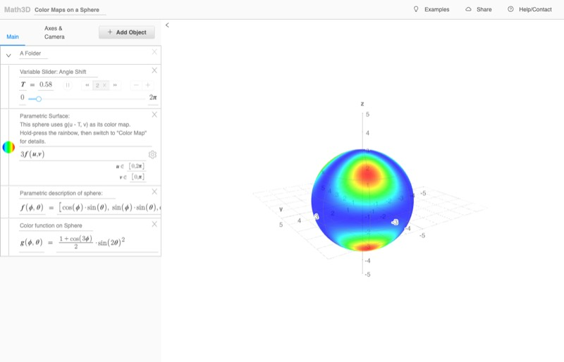 | 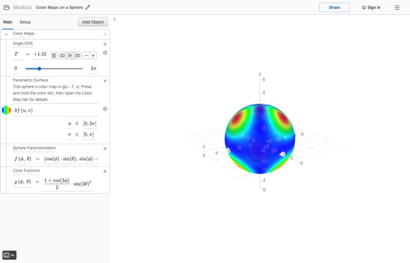 |
| 53 fps · 18.7 ms/frame                                                                                           | 60 fps · 8.5 ms/frame                                                                                          |

### Ripple

Explicit surface · 64 × 64, solid color · `sin(2√(x²+y²) − T) / (1 + 0.3(x²+y²))`

| math3d-react                                                              | math3d-next                                                             |
| ------------------------------------------------------------------------- | ----------------------------------------------------------------------- |
| 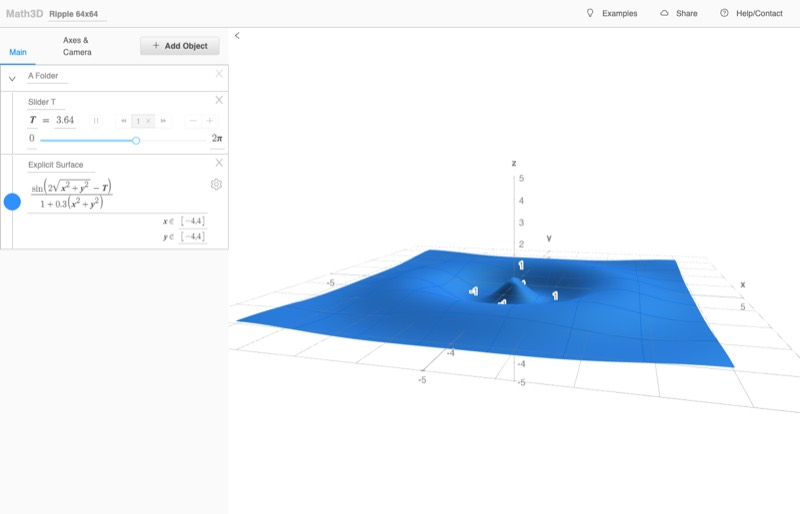 | 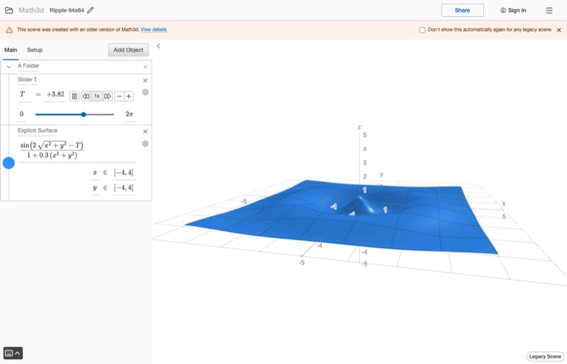 |
| 60 fps · 5.2 ms/frame                                                     | 60 fps · 4.9 ms/frame                                                   |

### Ripple, color map

Explicit surface · 128 × 128, rainbow color map · `same surface; color (1 + sin(2√(x²+y²) − T)) / 2`

| math3d-react                                                                                       | math3d-next                                                                                      |
| -------------------------------------------------------------------------------------------------- | ------------------------------------------------------------------------------------------------ |
| 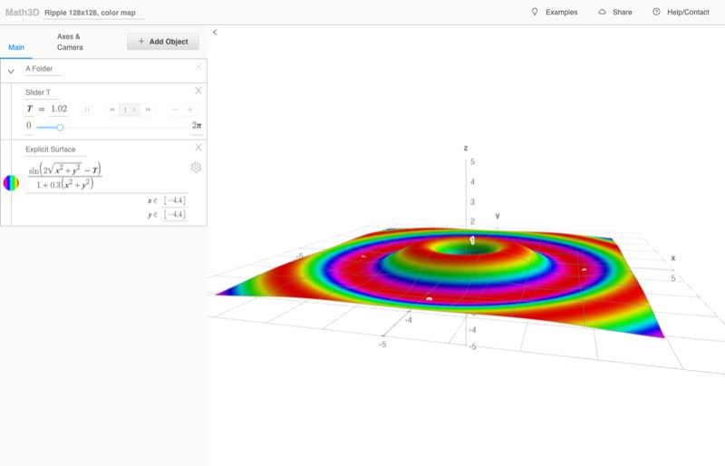 | 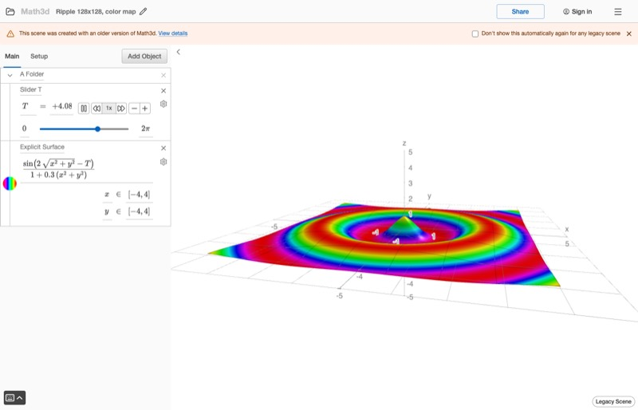 |
| 56 fps · 17.5 ms/frame                                                                             | 60 fps · 9.9 ms/frame                                                                            |

### Ripple, color map

Explicit surface · 256 × 256, rainbow color map · `same as above`

| math3d-react                                                                                       | math3d-next                                                                                      |
| -------------------------------------------------------------------------------------------------- | ------------------------------------------------------------------------------------------------ |
| 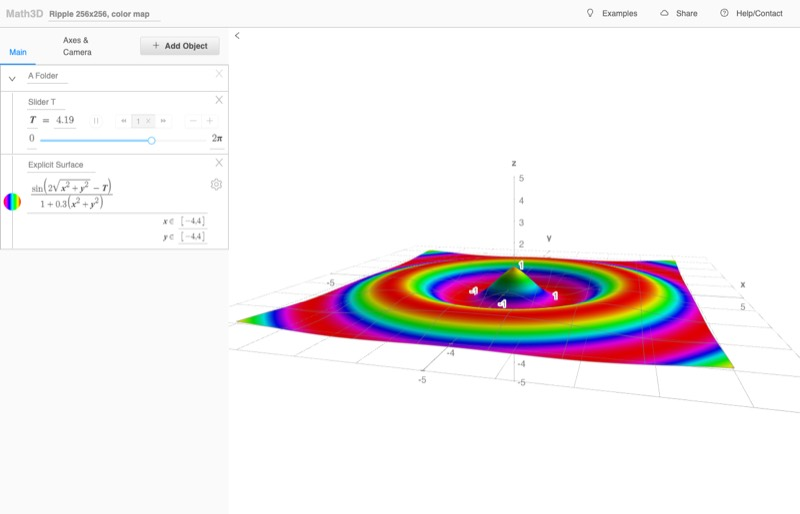 | 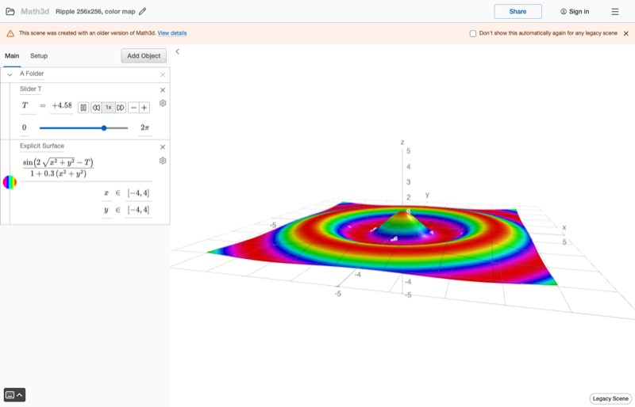 |
| 19 fps · 50.8 ms/frame                                                                             | 36 fps · 27.8 ms/frame                                                                           |

### Wavy torus, color map

Parametric surface · 96 × 96, temperature color map · `[(2+cos v) cos u, (2+cos v) sin u, sin v + 0.4 sin(3u+T)]`

| math3d-react                                                                                           | math3d-next                                                                                          |
| ------------------------------------------------------------------------------------------------------ | ---------------------------------------------------------------------------------------------------- |
| 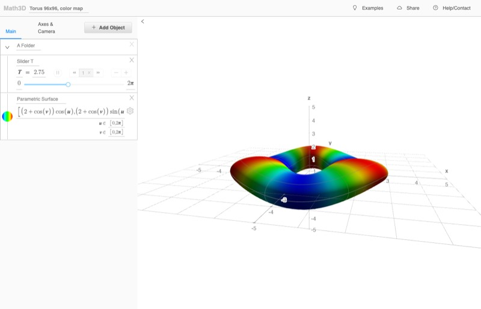 | 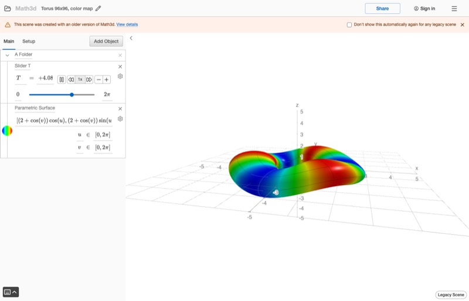 |
| 60 fps · 16.4 ms/frame                                                                                 | 60 fps · 7.4 ms/frame                                                                                |

### Shell, user function

Parametric surface · 128 × 128, solid color, f and A user-defined · `f(u,v) = e^{0.12u}[(1+A cos v) cos u, …], A = 0.6 + 0.3 sin T`

| math3d-react                                                                                                    | math3d-next                                                                                                   |
| --------------------------------------------------------------------------------------------------------------- | ------------------------------------------------------------------------------------------------------------- |
| 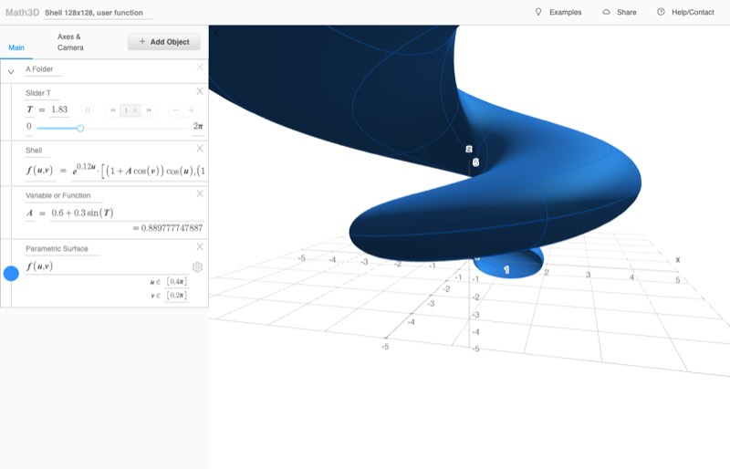 | 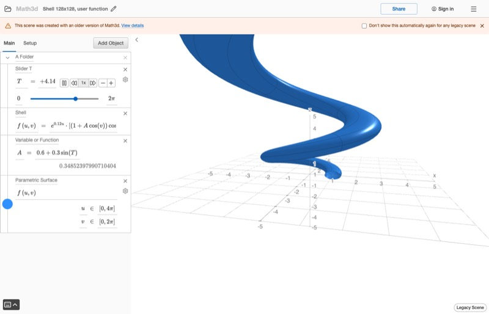 |
| 56 fps · 17.5 ms/frame                                                                                          | 60 fps · 7.4 ms/frame                                                                                         |

### Moving sphere

Implicit surface · 20 samples per axis · `(x − T)² + y² + z² = 4`

| math3d-react                                                                             | math3d-next                                                                            |
| ---------------------------------------------------------------------------------------- | -------------------------------------------------------------------------------------- |
| 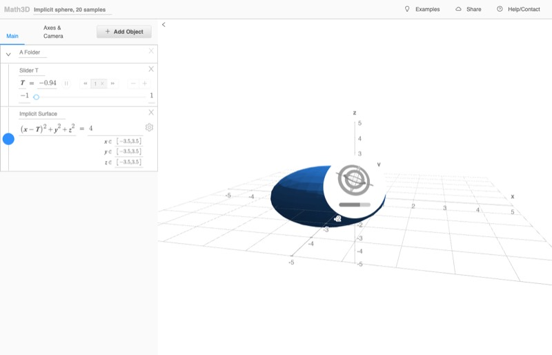 |  |
| 60 fps · 14.5 ms/frame                                                                   | 60 fps · 4.7 ms/frame                                                                  |

### Moving sphere

Implicit surface · 40 samples per axis · `(x − T)² + y² + z² = 4`

| math3d-react                                                                             | math3d-next                                                                            |
| ---------------------------------------------------------------------------------------- | -------------------------------------------------------------------------------------- |
|  | 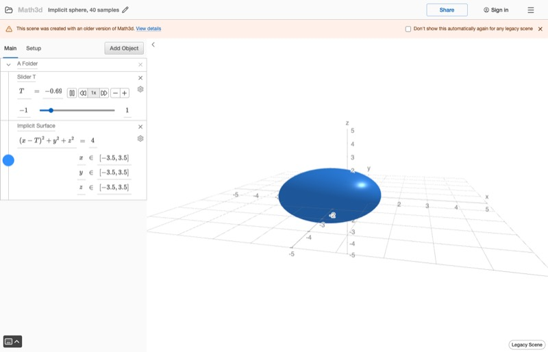 |
| 11 fps · 89.3 ms/frame                                                                   | 60 fps · 6.0 ms/frame                                                                  |

### Gyroid

Implicit surface · 20 samples per axis · `sin(T x) cos y + sin y cos z + sin z cos x = 0`

| math3d-react                                                             | math3d-next                                                            |
| ------------------------------------------------------------------------ | ---------------------------------------------------------------------- |
| 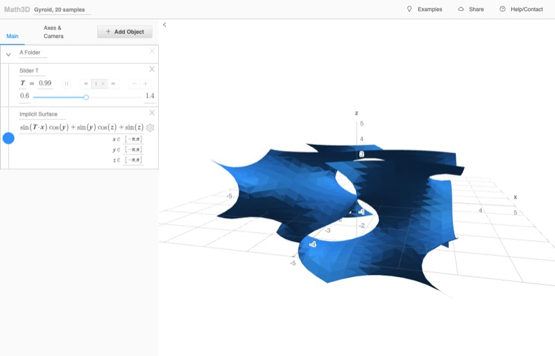 |  |
| 24 fps · 42.0 ms/frame                                                   | 60 fps · 4.7 ms/frame                                                  |

### Gyroid

Implicit surface · 40 samples per axis · `sin(T x) cos y + sin y cos z + sin z cos x = 0`

| math3d-react                                                             | math3d-next                                                            |
| ------------------------------------------------------------------------ | ---------------------------------------------------------------------- |
| 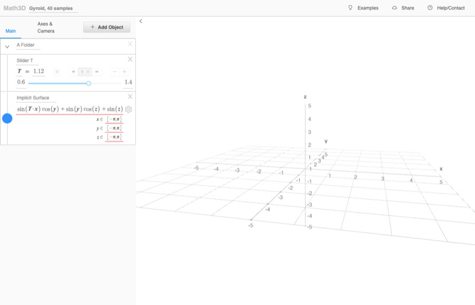 | 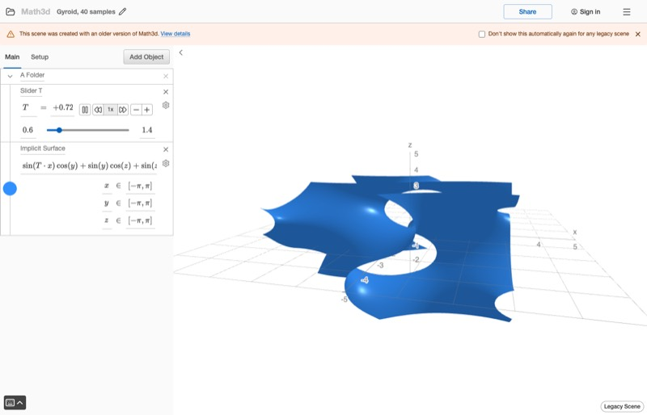 |
| 3.6 fps · 277.9 ms/frame                                                 | 60 fps · 6.6 ms/frame                                                  |

### Vector field

Vector field · 10 × 10 × 5 = 500 arrows · `[−y + 0.5 sin(z+T), x, 0.5 cos(x+T)]`

| math3d-react                                                                       | math3d-next                                                                      |
| ---------------------------------------------------------------------------------- | -------------------------------------------------------------------------------- |
| 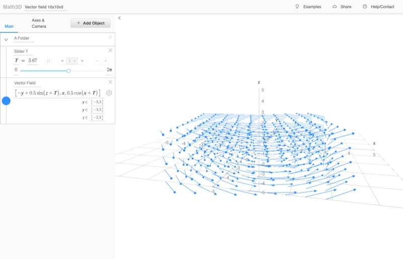 | 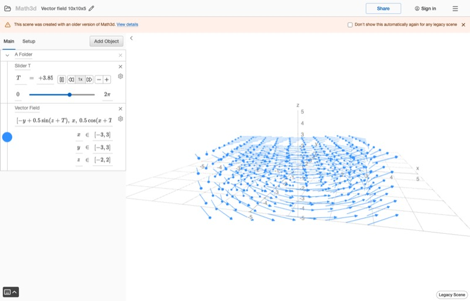 |
| 60 fps · 4.8 ms/frame                                                              | 60 fps · 4.8 ms/frame                                                            |

### Vector field

Vector field · 20 × 20 × 10 = 4,000 arrows · `[−y + 0.5 sin(z+T), x, 0.5 cos(x+T)]`

| math3d-react                                                                          | math3d-next                                                                         |
| ------------------------------------------------------------------------------------- | ----------------------------------------------------------------------------------- |
| 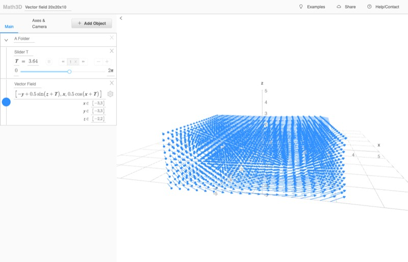 | 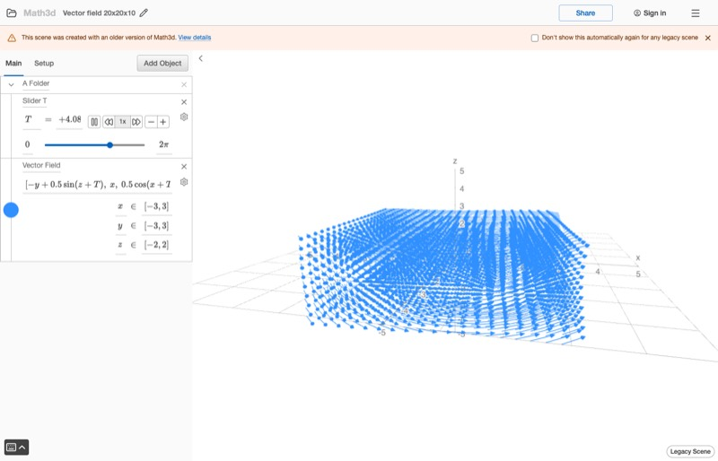 |
| 60 fps · 5.4 ms/frame                                                                 | 60 fps · 4.9 ms/frame                                                               |

## Method

- The scenes are saved on production in math3d-react's format, so both apps load the same ones; math3d-next translates each on load and draws with three.js (WebGPU). Scene keys (URL ids): `scripts/scene_keys.json`; definitions: `scripts/scenes.py`.
- Playwright with the full Chromium (real GPU) on an M1 Pro, on AC power, 1400 × 900 window at device pixel ratio 1, fresh page per run. Wait for the canvas, settle 5 s, then record 5 s of `requestAnimationFrame` intervals and the change in Chrome's `TaskDuration` metric.
- Main-thread ms per frame counts both apps' editor UI too (the slider readout updates each frame).
- math3d-react's medians are within 6% of the 2026-11-20 report's, which found math3d.org 3–10% faster than a local build of math3d-react.
- Raw results: `results/{x1,x4}/results.jsonl`, and `results/run.log` (one line per run, power source per round).
- To re-run: make a new folder `docs/reports/<date>-<name>/` holding only a copy of `scripts/` and `.gitignore`; from it run `scripts/run.sh`, edit the per-run text in `scripts/report_template.md` (listed in its leading comment), then run `python3 scripts/build_report.py <release>`.
